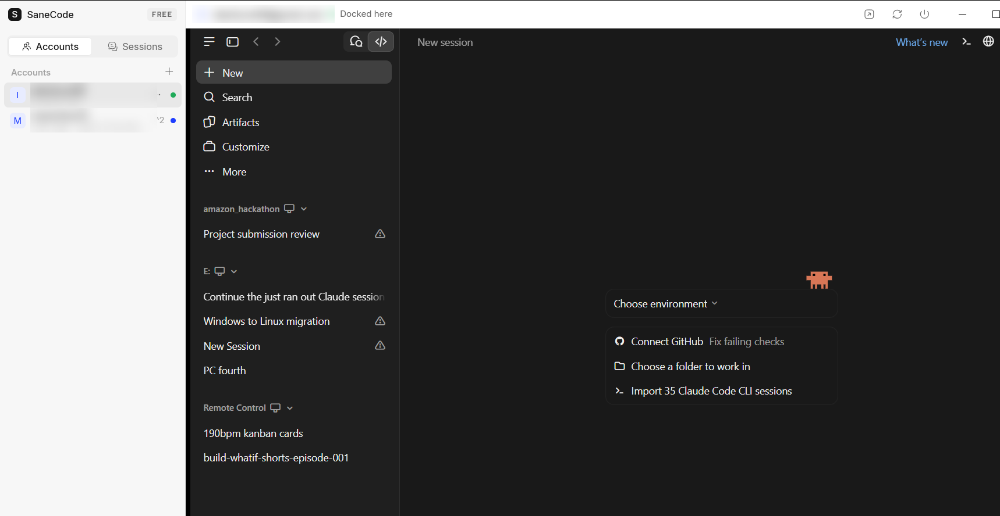
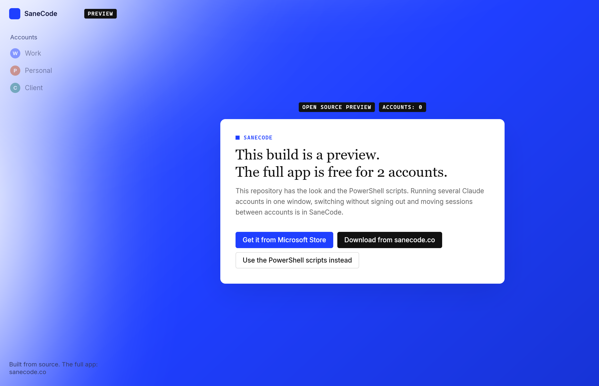

<div align="center">

# Multiple Claude Desktop accounts on Windows

**Run two or more Claude accounts on one PC, at the same time: work and personal, Pro and Max, your
own and a client's. Each keeps its own sign-in.**

Use **[SaneCode](https://sanecode.co/?ref=github)** (every account in one window, free for 2 accounts),
or the free PowerShell scripts in this repo if you'd rather do it by hand.

<a href="https://sanecode.co/store/"></a>
<a href="https://sanecode.co/?ref=github"></a>


</div>



- **The official Claude Desktop app, unmodified.** Each account is Claude started with its own data folder, so Claude's own updates keep working.
- **Every account stays signed in.** No logging out and back in to switch.
- **Chats and the Code tab (Claude Code) in every account,** each with its own login, plan and usage limit.
- **Its own window per account** with the scripts, or **all of them in one window** with SaneCode.
- **MIT, no admin rights.** Plain PowerShell you can read in five minutes.

| | These scripts | SaneCode Free | SaneCode Pro |
| --- | :---: | :---: | :---: |
| Several Claude accounts signed in at once | ✅ | ✅ 2 accounts | ✅ unlimited |
| Every account in one window, switch with a click | — | ✅ | ✅ |
| Side-by-side layouts | — | ✅ | ✅ |
| Continue a Code-tab session in another account | — | ✅ | ✅ |
| Same MCP servers in every account | — | ✅ | ✅ |
| Sign-in lands in the right account | by hand (`Send-ClaudeSignIn`) | ✅ | ✅ |
| Failover when an account hits its usage limit | — | — | ✅ |
| Claude in Chrome for every account in one Chrome profile | — | — | ✅ |
| Install | PowerShell | Store or installer | Store or installer |

## Contents

- [Why can't Claude Desktop use two accounts at once?](#why-cant-claude-desktop-use-two-accounts-at-once)
- [Problems people hit, and what fixes them](#problems-people-hit-and-what-fixes-them)
- [Use the PowerShell scripts instead](#use-the-powershell-scripts-instead)
- [How it works](#how-it-works)
- [FAQ](#faq)

## Why can't Claude Desktop use two accounts at once?

Claude Desktop keeps one login in one data folder, so the app is one account at a time. Switching
means signing out and signing in again. People ask for it on Anthropic's tracker: *"Claude Desktop
currently requires users to sign out and sign back in to switch between different Claude accounts"*
([anthropics/claude-code#18435](https://github.com/anthropics/claude-code/issues/18435)). Claude's
mobile apps got account switching in October 2026; the desktop app didn't
([@claudeai](https://x.com/claudeai/status/2115859380143030507)).

The fix is the same for every tool, this repo included: start Claude Desktop once per account, each
copy with its own data folder.

## Problems people hit, and what fixes them

**"I log out and in every time I switch."** A Microsoft researcher on X: *"please let me be logged
into my msft and my personal account at the same time. i log out and in every time i switch"*
([@DimitrisPapail](https://x.com/DimitrisPapail/status/2114817412641992999)). Another developer: *"I
have spent 40 minutes trying to log out of my personal account and into my work organization's
Claude Code account"* (#22872).
→ Give each account its own folder (the scripts), or keep them all open in one window (SaneCode).

**"I have a work account (Team) and a personal Max and want both at once."** The most common
Reddit question: [2 accounts simultaneously on Windows Claude desktop app?](https://www.reddit.com/r/ClaudeAI/comments/1xli7z4/2_accounts_simultaneously_on_windows_claude/),
[same PC with two different accounts simultaneously?](https://www.reddit.com/r/ClaudeAI/comments/1wvv9ud/is_there_a_way_to_use_claude_desktop_on_same_pc/).
→ `New-ClaudeProfile Work` and `New-ClaudeProfile Personal`. Guide:
[personal and work Claude account on one computer](https://sanecode.co/blog/claude-personal-and-work-account/).

**"The sign-in opened in the wrong Claude window."** With several copies open, Windows hands the
`claude://` sign-in link to one of them, *"usually not the one that is signing in"*
([twindesk](https://github.com/MartinFerret/twindesk)).
→ `Send-ClaudeSignIn Work` sends a copied link to the right account. SaneCode routes it for you.

**"I hit my usage limit in the middle of a task."** *"Every time the first one ran out, I did it by
hand: log out, log in with the other account, restart the session"*
([inulute on dev.to](https://dev.to/inulute/how-i-run-two-claude-accounts-as-one-49b1)).
→ With both accounts signed in you just switch windows. SaneCode can move a Code-tab conversation to
the other account with its full history ([Session Relay](https://sanecode.co/docs/continue-claude-session-in-another-account/)),
and Pro does it automatically when a limit hits.

**"Claude in Chrome says the extension is not connected."** The extension is signed into one Claude
account, and *"browser tasks fail with 'Browser extension is not connected'"* when the desktop app
uses another ([#107853](https://github.com/anthropics/claude-code/issues/107853)).
→ A Chrome profile per account, or SaneCode's shared browser. Guide:
[Claude in Chrome with multiple Claude accounts](https://sanecode.co/blog/claude-in-chrome-multiple-accounts/).

**"My MCP servers are only in one account."** Each account reads its own
`claude_desktop_config.json`. → Copy the `mcpServers` block, or let SaneCode keep one list for all.
Guide: [share MCP servers across Claude accounts](https://sanecode.co/blog/share-mcp-servers-across-claude-accounts/).

**"Will I lose my Claude Code chats if I use two Pro accounts?"**
([r/ClaudeCode](https://www.reddit.com/r/ClaudeCode/comments/1xcf3kw/can_i_use_two_claude_pro_accounts_with_claude/))
→ No. Code-tab conversations are files in your user folder that every account can see; only each
account's list differs. Guide: [Claude Code with multiple accounts](https://sanecode.co/blog/claude-code-multiple-accounts/).

## Use the PowerShell scripts instead

```powershell
irm https://raw.githubusercontent.com/dusy4/multiple-claude-accounts-desktop-app/main/scripts/install.ps1 | iex
New-ClaudeProfile Work
New-ClaudeProfile Personal
```

| Command | What it does |
| --- | --- |
| `New-ClaudeProfile <name>` | Creates the account's folder and a Start-menu shortcut (*Claude accounts → Claude - name*), then opens it so you can sign in |
| `Start-ClaudeProfile <name>` | Opens that account in its own Claude window |
| `Get-ClaudeProfile` | Lists your accounts and which are open |
| `Send-ClaudeSignIn <name>` | Sends a copied `claude://` sign-in link to that account |

You need Claude Desktop from [claude.ai/download](https://claude.ai/download), opened once. Nothing is
deleted, ever. Step by step with screenshots:
[How to use multiple Claude accounts on one computer](https://sanecode.co/blog/switch-between-claude-accounts/).

## How it works

Claude Desktop is an Electron app. Started with `--user-data-dir=<folder>` it keeps its login,
settings and MCP servers in that folder instead of the default one, so each folder is a separate,
signed-in Claude account. On Windows the app is a Store (MSIX) package, and only folders under
`%LOCALAPPDATA%\Claude-Data` are exempt from Windows redirecting its writes, so the accounts live
there (`acct-<name>`). The scripts make one folder and one shortcut per account. SaneCode does the
same and docks every window beside its sidebar: [how SaneCode runs multiple Claude instances](https://sanecode.co/docs/how-sanecode-runs-multiple-claude-instances/).

## The preview app (`app/`)

`cargo run --release` in `app/` builds a preview with SaneCode's look. It doesn't run Claude: it
points you to the full app and to these scripts. It's built with [rune](https://github.com/anomalyco/rune).



## FAQ

**How do I use multiple Claude accounts on one computer?** Run Claude Desktop once per account, each
with its own data folder: the scripts above, or SaneCode.

**Is there a Claude account switcher for Windows?** Yes: SaneCode keeps every account open and
switches with a click, without signing out. The scripts open each account in its own window.
Compared: [Claude multi-account managers for Windows](https://sanecode.co/blog/claude-multi-account-manager-windows/).

**Can I run two Claude Desktop windows at the same time?** Yes, one per account. Side by side in
one window: [side-by-side layouts](https://sanecode.co/docs/claude-desktop-side-by-side-layouts/).

**Is it allowed to have multiple Claude accounts?** See what Anthropic's terms say:
[Are multiple Claude accounts allowed?](https://sanecode.co/blog/are-multiple-claude-accounts-allowed/)

**Does it work with Claude Code?** Yes. In the desktop Code tab each account has its own login. In a
terminal, use `CLAUDE_CONFIG_DIR`: [Claude Code with multiple accounts](https://sanecode.co/blog/claude-code-multiple-accounts/).

**Mac or Linux?** The scripts and SaneCode are Windows only for now.

**Why not a second Windows user?** You'd switch the whole desktop:
[why not a second Windows user](https://sanecode.co/blog/second-windows-user-for-claude-account/).

---

MIT License. Not affiliated with Anthropic. Claude is a trademark of Anthropic, PBC.
